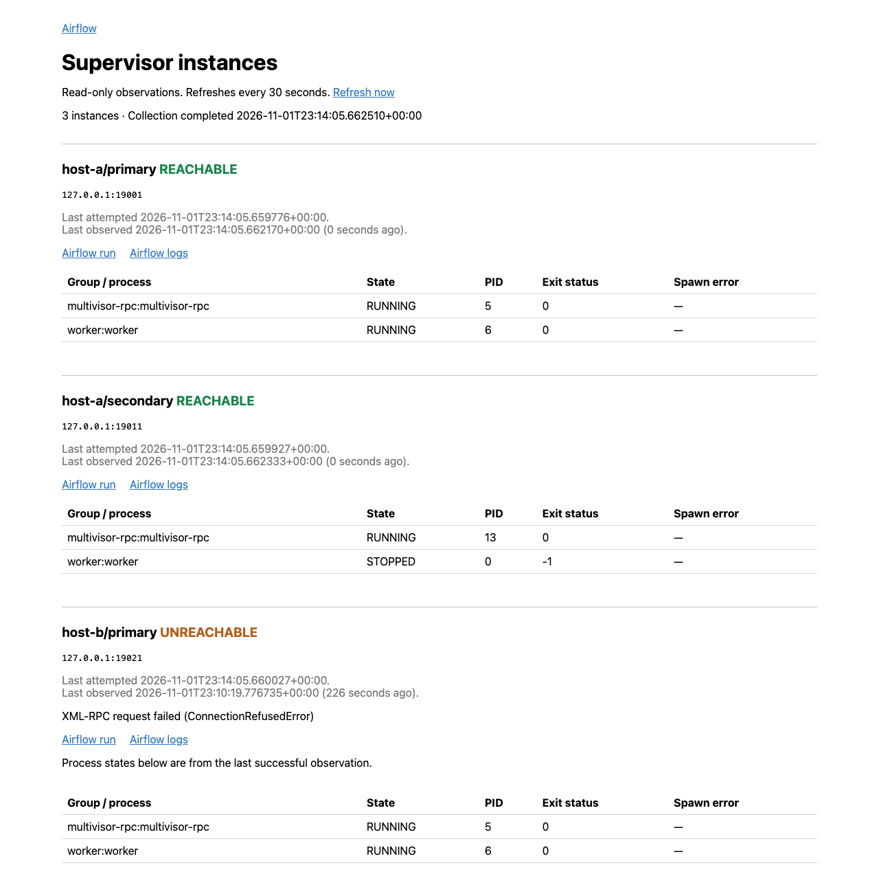

---
myst:
  heading_anchors: 3
---

# View three Supervisor instances across two container hosts

In this tutorial, we will collect three supervisord instances into one read-only
Airflow page, stop one process, and disconnect one host.

Use a local Airflow 2 or 3 installation with a scheduler, worker, and authenticated
web interface. The worker must run on the machine exposing the container ports.
Install Podman and `podman-compose`. The two containers represent separate hosts;
this exercise does not simulate physical host failure or test replica recovery.

## Start the instances

From this repository's root, install the viewer in the Airflow environment:

```bash
pip install -e .
cd examples/supervisor_viewer
podman-compose -p laminar-supervisor-viewer up -d --build
```

Host A runs two supervisord instances; host B runs one. Each manages a `worker`
program and a Multivisor event listener. Published ports bind only to loopback.
The `demo` credentials in these files belong to this disposable example.

Check startup:

```bash
podman-compose -p laminar-supervisor-viewer logs host-a host-b
```

Both hosts should print `Supervisor instances ready`.

## Collect status in Airflow

Copy `collector.py` into your Airflow DAG folder. Restart the Airflow webserver
(Airflow 2) or API server (Airflow 3) to load the installed plugin. Unpause and
trigger `supervisor-observations`.

Open **Supervisor Viewer** under **Browse** on Airflow 2 or 3.
The page is also at `/airflow-supervisor/`.

You should see `host-a/primary`, `host-a/secondary`, and `host-b/primary`, each
marked `REACHABLE`. Their tables show `worker` and `multivisor-rpc` in `RUNNING`
state. Notice the different ports for the two instances on host A.

The collector runs once per minute. The page reloads every 30 seconds and shows
the time of each probe. No Airflow run/log links are configured in this example;
associate existing workload runs using the
[viewer setup guide](supervisor-viewer-how-to.md).

The view below shows the stopped-process and disconnected-host cases we will
create next, with links to an associated Airflow monitoring run:



## Stop one process

Stop only the secondary instance's worker:

```bash
podman-compose -p laminar-supervisor-viewer exec host-a \
  supervisorctl -c /tmp/supervisor-9011/supervisord.conf -u demo -p demo stop worker
```

After the next collection, `host-a/secondary` remains `REACHABLE` and its worker
shows `STOPPED`. The primary instance and host B's worker remain running.

## Disconnect host B

```bash
podman-compose -p laminar-supervisor-viewer stop host-b
```

After the next collection, `host-b/primary` shows `UNREACHABLE`. Its previous
process states remain visible with a last-successful-observation notice and
timestamp. Both host A instances continue updating.

Pause `supervisor-observations` for more than two minutes. Refresh the page;
the instances now show `STALE`. Unpause it to resume observation.

## Inspect the Multivisor comparison

Open `http://127.0.0.1:22000` and log in with username `reader` and password
`demo`. Multivisor also shows the three instances and provides native process
logs. Its login permits process-control actions, so keep this comparison service
local. The [viewer explanation](explanation.md#why-the-viewer-uses-snapshots)
describes the reason for using a separate read-only Airflow view.

## Remove the example

```bash
podman-compose -p laminar-supervisor-viewer down
```

Remove the copied DAG from Airflow. The remaining snapshot becomes stale until
you replace it or delete the `airflow-supervisor:instances` Variable.
